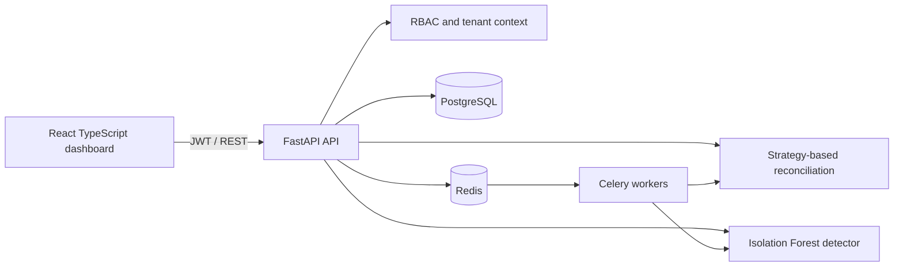
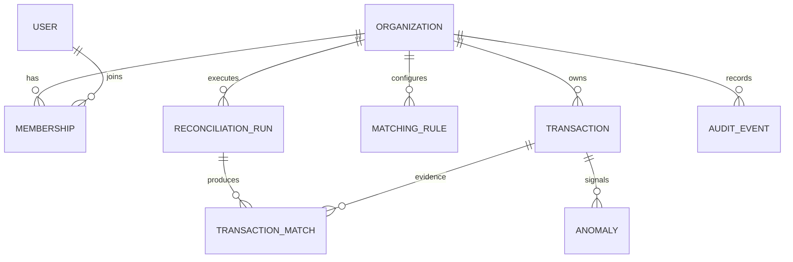

# Architecture

The local demo defaults to SQLite so the core workflow can run without infrastructure. Docker Compose switches the same SQLAlchemy models to PostgreSQL and starts Redis/Celery. Matching is deterministic: records are sorted, candidates are indexed, tie-breaking uses confidence, amount difference, then stable IDs. Database constraints prevent a transaction from being consumed twice in one run.

## ER diagram

## Trust boundaries

Uploaded data enters through validation and tenant context. External LLM access is not enabled; deterministic explanations operate only on stored match evidence. Public demo data is synthetic and isolated in a dedicated tenant.
